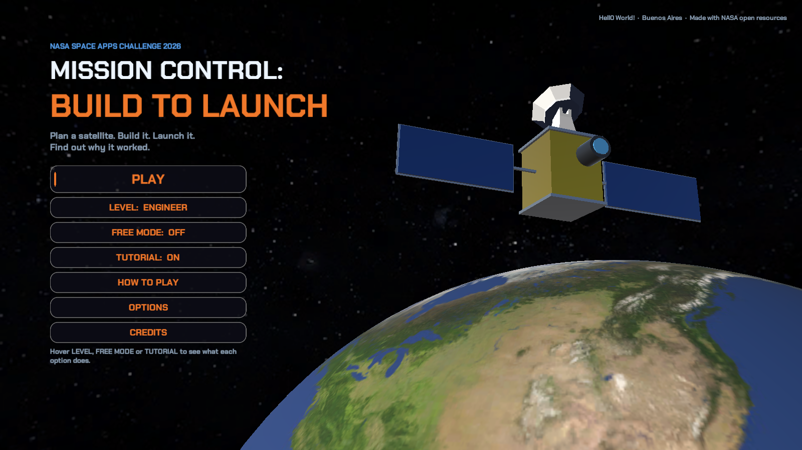
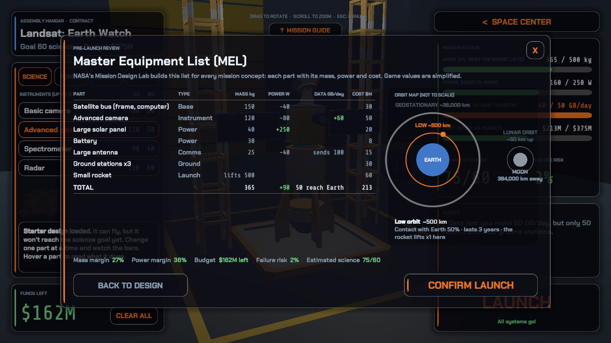
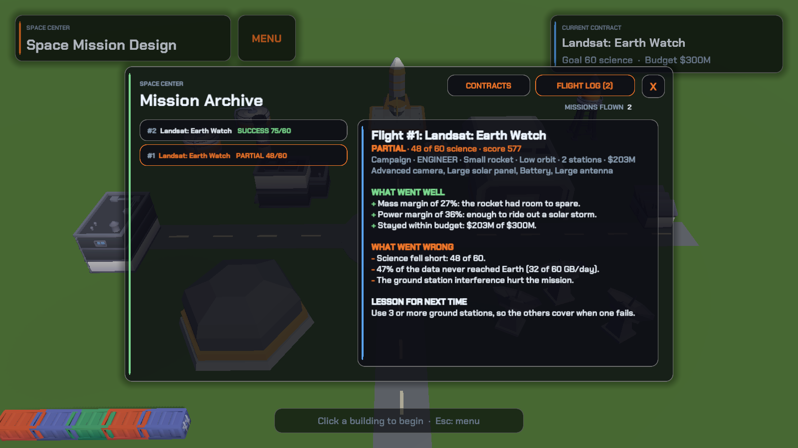

# Mission Control: Build to Launch

**Design a satellite mission, launch it, and learn why it worked.**

A free 3D browser game by **Hell0 World!**, created for **NASA Space Apps Challenge 2026**, challenge **Space Mission Design Game**, Buenos Aires.

## Play now

**[Play in your browser](https://eugenio-navarro.itch.io/mission-control-build-to-launch)**

No installation or account required. Use a desktop browser with a mouse and keyboard, click **Run game**, and let Unity load. Use fullscreen for a larger view. The game interface is in English.

[Watch the official demo (29.4 seconds)](https://github.com/eugenio-navarro/SpaceMissionGame/raw/refs/heads/main/docs/submission/MissionControl_Demo.mp4)



## The game

You run a satellite mission from a 3D space center. Accept a contract, assemble a spacecraft, choose its rocket and orbit, review the equipment list, and launch. Your goal is to bring enough useful science back to Earth within the mission budget.

Every part affects mass, electricity, data transmission and cost. A better camera is useful only if your satellite can power it and send its data home. Live resource bars show the consequences of each selection.

After launch, the game explains the outcome, suggests a change, compares your spacecraft with a real mission, and records the flight for you to review.

## Your first mission

1. Select **Cadet** for a starter design, or **Engineer** to build from scratch. Keep **Tutorial: ON** and **Free Mode: OFF** for a guided campaign.
2. Press **Play**, click **Mission Control**, and accept **Landsat: Earth Watch**.
3. Enter the **Assembly Hangar**. Hover over a part to read its description; click to add or remove it.
4. Use the four tabs to select your equipment. Watch **mass, power, data, cost, science and risk** on the right.
5. Resolve the blocking alerts. Press **Launch** to review the equipment list and orbit map, then confirm the flight.
6. During ascent, press **Space** or click the separation prompt when the marker reaches the green zone. The flight computer separates automatically if you do not intervene.
7. Read the result and its explanation. Choose **Redesign** to improve the previous spacecraft, or return to the space center and open the **Mission Archive**.

| Hangar tab | What you choose |
| --- | --- |
| Science | Up to three instruments: basic camera, advanced camera, spectrometer, radar |
| Power | Small or large solar panel and an optional battery |
| Rocket | Small, medium or large rocket and an orbit allowed by the contract |
| Comms | Small or large antenna and one to four ground stations |

### A design to try

For **Landsat: Earth Watch** on **Engineer**, choose an **advanced camera, large solar panel, battery, large antenna, small rocket, low orbit, and two ground stations**.

Before events, this design costs **$203M**, weighs **365 kg** against **500 kg** of capacity, uses **160 W** against **250 W** generated, and returns an estimated **60 science**, matching the goal. Random events and component failure can still change the final result. Try adding a third ground station and compare the communications performance.

## Contracts

Complete a campaign contract successfully to unlock the next. A partial result does not unlock it. These are the standard **Engineer** budgets.

| Contract | Objective | Science goal | Budget | Available orbits |
| --- | --- | ---: | ---: | --- |
| Landsat: Earth Watch | Track changes in forests and ice | 60 | $300M | Low Earth, geostationary |
| Hubble: Deep Field | Study faraway galaxies | 70 | $400M | Low Earth, geostationary |
| LRO: Lunar Mapping | Map the lunar south pole | 40 | $500M | Lunar |

Radar is unavailable in the Hubble contract. Other parts remain selectable subject to contract restrictions.

## Difficulty and Free Mode

| Difficulty | Budget | Failure risk | Starting design |
| --- | --- | --- | --- |
| Cadet | 25% more, rounded to $5M increments | Half standard risk, rounded to a whole percent with a 1% minimum | A launchable starter design to improve toward the science goal |
| Engineer | Standard | Standard | Build from scratch unless a saved design exists |
| Flight Director | 15% less, rounded to $5M increments | 1.5 times standard risk | Build from scratch unless a saved design exists |

Change difficulty and **Free Mode** in the main menu. Free Mode opens all three contracts and removes the budget limit. Mass, power and contract restrictions still apply. Free flights appear in the flight log, but do not unlock campaign contracts or enter the campaign ranking.

## Mission rules

The science score depends on the data that actually reaches Earth and the contract's detail factor for the selected orbit.

- **Mass:** the satellite must fit its rocket's payload capacity. More demanding orbits reduce how much the rocket can carry.
- **Power:** the panel must cover consumption. Without a battery in an orbit with eclipses, average generation drops to 65%.
- **Communications:** the antenna, orbit contact and ground stations limit the data received on Earth.
- **Budget:** the spacecraft, rocket and ground stations must fit the contract allowance in campaign mode.
- **Margins:** spare power and payload capacity reduce component failure risk.

The preflight **Master Equipment List (MEL)** shows equipment mass, power and cost, plus margins, risk and an orbit map. A launchable design can still fall short of the science goal. Read warnings as well as blocking alerts.

Each flight encounters a **solar storm**, **ground station interference**, or **calm conditions**. A power margin of at least **20%** protects against the game's storm effect. At least **three ground stations** protect against the interference penalty. A separate risk roll can cause a component failure and halve the science result.

| Result | Final science |
| --- | --- |
| Success | At least 100% of the goal |
| Partial | At least 60%, but below 100% |
| Failed | Below 60% |

Results explain what happened and what to try next. A trade study checks launchable single-change alternatives for more estimated science or equal science with less risk. Real-mission comparisons include **Landsat 9, Hubble, LRO and SAOCOM**.

## Mission Archive and saved progress

Open the glass dome in the space center to review flights. The log keeps the **latest 30 flights**, including selected parts, difficulty, result, event, margins, what went well, what went wrong and the lesson.

Campaign rankings retain the **top five scores per contract**. Ranking score is `science * 10 + unused budget in $M`.

The game saves designs, campaign progress, tutorials, flight history and settings locally through Unity **PlayerPrefs**. Progress belongs to the browser/device used to play and can be lost if site data is cleared. There are no cloud saves or shared online leaderboards. **New Game** resets progress and keeps music and effects volume settings.

## Controls

| Input | Action |
| --- | --- |
| Mouse click | Select buildings, parts and interface controls |
| Mouse hover | Read part descriptions and menu hints |
| Drag with left or right mouse button outside the UI | Orbit the hangar camera |
| Mouse wheel outside the UI | Zoom in the hangar |
| Esc | Close a scene panel or open the menu; the browser may use the first press to leave fullscreen |
| Space or click the separation prompt | Separate the first rocket stage during the timing challenge |
| Enter or the skip button | Skip the launch sequence |

**How to Play / Mission Guide** explains the concepts. **Options** includes separate music and effects volume controls and access to the guide and credits.

## Screenshots

### Space center


### Preflight equipment review


### Results


### Flight history


## About the simulation

Part masses, costs, power levels and data rates are simplified game values. Orbit lifetimes and real mission facts provide context; they do not form a continuous multiyear operations simulation. Launch follows an animated sequence with a stage-separation challenge. The player designs the mission rather than manually piloting the rocket.

The current game is single-player. It does not include online multiplayer, a live orbital physics solver or cloud saves.

## Run the Unity project

1. Install **Unity 6.6, exactly 6000.6.9f1**, with **Web Build Support** for browser builds.
2. Install Git LFS and clone:

   ```sh
   git lfs install
   git clone https://github.com/eugenio-navarro/SpaceMissionGame.git
   cd SpaceMissionGame
   git lfs pull
   ```

3. Add the project to Unity Hub and open it with that editor version.
4. Open `Assets/Scenes/MenuPrincipal.unity` and press Play.

The five build scenes, in order, are `MenuPrincipal`, `CentroEspacial`, `Hangar`, `Lanzamiento` and `Resultados`. The project uses **C#, URP, uGUI and the Input System**. The current part and contract catalog is `Assets/Scripts/Data/TestCatalog.cs`. Rules are in `MissionCalculator.cs` and `MissionOutcome.cs`.

### Browser build

Select **Web** in **File > Build Profiles**, include all five scenes, and set **Compression Format: Disabled** for the current itch.io setup. Build to `Builds/WebGL`.

The publication wrapper in `docs/web-player/` preserves the responsive 16:9 layout. Copy its `index.html` and `TemplateData/style.css` over the generated files after building. Zip the **contents** of the build folder so `index.html` sits at the archive root. Upload as HTML and select **This file will be played in the browser**. The published embed is **960 x 540**, with fullscreen available.

Generated Unity caches and builds are excluded from Git. The playable release is hosted on itch.io.

## Credits and AI use

- **Team:** Hell0 World!, Buenos Aires.
- **Models and particles:** Kenney, CC0.
- **Planet and sky textures:** Solar System Scope, CC BY 4.0.
- **Fonts:** Chakra Petch and Share Tech Mono, SIL Open Font License.
- **Music and effects:** synthesized in the game by code.
- **AI assistance:** Claude assisted with research, design, C# code, scene builders and English text, as recorded in the project references. ChatGPT assisted with publication, the responsive web player, documentation and submission materials. No AI-generated images or video were created for this delivery package. Screenshots show the game.

See [REFERENCES.md](REFERENCES.md) for source URLs, licenses and the detailed AI disclosure, and [submission materials](docs/submission/SUBMISSION.md) for the prepared form text and delivery checklist.
