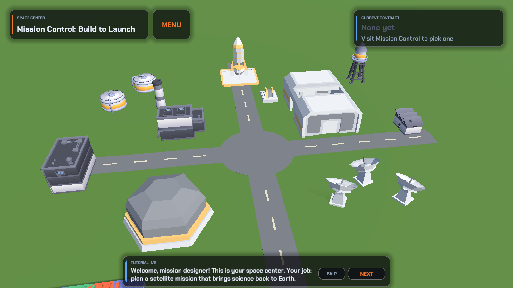
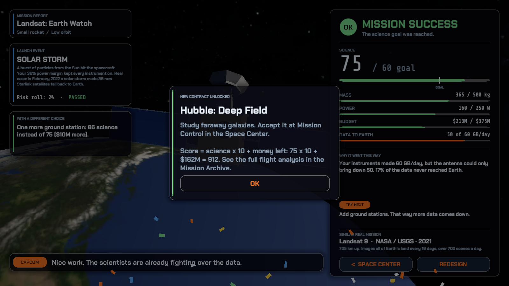

# Mission Control: Build to Launch

**Design a satellite mission, launch it, and learn why it worked.**

A free 3D browser game by **Hell0 World!**, created for **NASA Space Apps Challenge 2026**, challenge **Space Mission Design Game**, Buenos Aires.

## Play now

**[Play in your browser](https://eugenio-navarro.itch.io/mission-control-build-to-launch)**

No installation or account required. Use a desktop browser with a mouse and keyboard, click **Run game**, and let Unity load. Use fullscreen for a larger view. The game interface is in English.

[Watch the official demo (29.4 seconds)](https://github.com/eugenio-navarro/SpaceMissionGame/raw/refs/heads/main/docs/submission/MissionControl_Demo.mp4)


## The game

You run a satellite mission from a 3D space center. Accept a contract, assemble a spacecraft, choose its rocket and orbit, review the equipment list, and launch. Your goal is to bring enough useful science back to Earth within the mission budget.

Every part affects mass, electricity, data transmission and cost. A better camera is useful only if your satellite can power it and send its data home. Live resource bars show the consequences of each selection.

After launch, the game explains the outcome, suggests a change, compares your spacecraft with a real mission, and records the flight for you to review.

## Your first mission

1. Select **Cadet** for a starter design, or **Engineer** to build from scratch. Keep **Tutorial: ON** and **Free Mode: OFF** for a guided campaign.
2. Press **Play**, click **Mission Control**, and accept **Landsat: Earth Watch**.
3. Enter the **Assembly Hangar**. Hover over a part to read its description; click to add or remove it.
4. Use the four tabs to select your equipment. Watch **mass, power, data, cost, science and risk** on the right.
5. Resolve the blocking alerts. Press **Launch** to review the equipment list and orbit map, then confirm the flight.
6. During ascent, press **Space** or click the separation prompt when the marker reaches the green zone. The flight computer separates automatically if you do not intervene.
7. Read the result and its explanation. Choose **Redesign** to improve the previous spacecraft, or return to the space center and open the **Mission Archive**.

| Hangar tab | What you choose |
| --- | --- |
| Science | Up to three instruments: basic camera, advanced camera, spectrometer, radar |
| Power | Small or large solar panel and an optional battery |
| Rocket | Small, medium or large rocket and an orbit allowed by the contract |
| Comms | Small or large antenna and one to four ground stations |

### A design to try

For **Landsat: Earth Watch** on **Engineer**, choose an **advanced camera, large solar panel, battery, large antenna, small rocket, low orbit, and two ground stations**.

Before events, this design costs **$203M**, weighs **365 kg** against **500 kg** of capacity, uses **160 W** against **250 W** generated, and returns an estimated **60 science**, matching the goal. Random events and component failure can still change the final result. Try adding a third ground station and compare the communications performance.

## Contracts

Complete a campaign contract successfully to unlock the next. A partial result does not unlock it. These are the standard **Engineer** budgets.

| Contract | Objective | Science goal | Budget | Available orbits |
| --- | --- | ---: | ---: | --- |
| Landsat: Earth Watch | Track changes in forests and ice | 60 | $300M | Low Earth, geostationary |
| Hubble: Deep Field | Study faraway galaxies | 70 | $400M | Low Earth, geostationary |
| LRO: Lunar Mapping | Map the lunar south pole | 40 | $500M | Lunar |

Radar is unavailable in the Hubble contract. Other parts remain selectable subject to contract restrictions.

## Difficulty and Free Mode

| Difficulty | Budget | Failure risk | Starting design |
| --- | --- | --- | --- |
| Cadet | 25% more, rounded to $5M increments | Half standard risk, rounded to a whole percent with a 1% minimum | A launchable starter design to improve toward the science goal |
| Engineer | Standard | Standard | Build from scratch unless a saved design exists |
| Flight Director | 15% less, rounded to $5M increments | 1.5 times standard risk | Build from scratch unless a saved design exists |

Change difficulty and **Free Mode** in the main menu. Free Mode opens all three contracts and removes the budget limit. Mass, power and contract restrictions still apply. Free flights appear in the flight log, but do not unlock campaign contracts or enter the campaign ranking.

## Mission rules

The science score depends on the data that actually reaches Earth and the contract's detail factor for the selected orbit.

- **Mass:** the satellite must fit its rocket's payload capacity. More demanding orbits reduce how much the rocket can carry.
- **Power:** the panel must cover consumption. Without a battery in an orbit with eclipses, average generation drops to 65%.
- **Communications:** the antenna, orbit contact and ground stations limit the data received on Earth.
- **Budget:** the spacecraft, rocket and ground stations must fit the contract allowance in campaign mode.
- **Margins:** spare power and payload capacity reduce component failure risk.

The preflight **Master Equipment List (MEL)** shows equipment mass, power and cost, plus margins, risk and an orbit map. A launchable design can still fall short of the science goal. Read warnings as well as blocking alerts.

Each flight encounters a **solar storm**, **ground station interference**, or **calm conditions**. A power margin of at least **20%** protects against the game's storm effect. At least **three ground stations** protect against the interference penalty. A separate risk roll can cause a component failure and halve the science result.

| Result | Final science |
| --- | --- |
| Success | At least 100% of the goal |
| Partial | At least 60%, but below 100% |
| Failed | Below 60% |

Results explain what happened and what to try next. A trade study checks launchable single-change alternatives for more estimated science or equal science with less risk. Real-mission comparisons include **Landsat 9, Hubble, LRO and SAOCOM**.

## Mission Archive and saved progress

Open the glass dome in the space center to review flights. The log keeps the **latest 30 flights**, including selected parts, difficulty, result, event, margins, what went well, what went wrong and the lesson.

Campaign rankings retain the **top five scores per contract**. Ranking score is `science * 10 + unused budget in $M`.

The game saves designs, campaign progress, tutorials, flight history and settings locally through Unity **PlayerPrefs**. Progress belongs to the browser/device used to play and can be lost if site data is cleared. There are no cloud saves or shared online leaderboards. **New Game** resets progress and keeps music and effects volume settings.

## Controls

| Input | Action |
| --- | --- |
| Mouse click | Select buildings, parts and interface controls |
| Mouse hover | Read part descriptions and menu hints |
| Drag with left or right mouse button outside the UI | Orbit the hangar camera |
| Mouse wheel outside the UI | Zoom in the hangar |
| Esc | Close a scene panel or open the menu; the browser may use the first press to leave fullscreen |
| Space or click the separation prompt | Separate the first rocket stage during the timing challenge |
| Enter or the skip button | Skip the launch sequence |

**How to Play / Mission Guide** explains the concepts. **Options** includes separate music and effects volume controls and access to the guide and credits.

## Screenshots

<<<<<<< HEAD
Cada evento elegible se sortea de forma independiente y pueden coincidir varios. Las probabilidades son valores de balance de la simulación.

- **Tormenta solar:** si el margen de energía es menor al 20%, se apaga el instrumento que más consume. Si no, el margen lo protege.
- **Interferencia en estación:** si hay menos de 3 estaciones, se baja un 20% menos de datos. Si hay 3 o más, las otras cubren.
- **Nubosidad (30%, contrato Tierra):** reduce a la mitad los datos de las cámaras que siguen activas. El radar conserva su producción.
- **Eclipse lunar prolongado (25%, contrato Luna en órbita lunar):** conserva 60% de producción sin batería, 85% con batería básica y 100% con batería extendida.
- **Calma:** ningún evento ocurrió. Tormenta e interferencia tienen 15% de probabilidad cada una.

La tablet **Mission Forecast** del hangar muestra probabilidades, coincidencias y ciencia estimada usando las mismas reglas del vuelo. El puntaje suma ciencia × 10 y un bonus por presupuesto ahorrado cuando se cumple la meta en campaña.
=======
### Space center


### Preflight equipment review

>>>>>>> 67306400d0ec165baa68b4130621682b16d4ae8a

### Results


### Flight history


## About the simulation

Part masses, costs, power levels and data rates are simplified game values. Orbit lifetimes and real mission facts provide context; they do not form a continuous multiyear operations simulation. Launch follows an animated sequence with a stage-separation challenge. The player designs the mission rather than manually piloting the rocket.

The current game is single-player. It does not include online multiplayer, a live orbital physics solver or cloud saves.

## Run the Unity project

1. Install **Unity 6.6, exactly 6000.6.9f1**, with **Web Build Support** for browser builds.
2. Install Git LFS and clone:

   ```sh
   git lfs install
   git clone https://github.com/eugenio-navarro/SpaceMissionGame.git
   cd SpaceMissionGame
   git lfs pull
   ```

3. Add the project to Unity Hub and open it with that editor version.
4. Open `Assets/Scenes/MenuPrincipal.unity` and press Play.

<<<<<<< HEAD
| ID | Nombre | Masa (kg) | Genera (W) | Costo ($M) |
|---|---|---|---|---|
| `panel_s` | Panel solar chico | 20 | 120 | 10 |
| `panel_m` | Panel solar mediano | 30 | 180 | 15 |
| `panel_l` | Panel solar grande | 40 | 250 | 20 |
| `bat` | Batería | 30 | — | 8 |
| `bat_extended` | Batería extendida | 55 | — | 18 |
=======
The five build scenes, in order, are `MenuPrincipal`, `CentroEspacial`, `Hangar`, `Lanzamiento` and `Resultados`. The project uses **C#, URP, uGUI and the Input System**. The current part and contract catalog is `Assets/Scripts/Data/TestCatalog.cs`. Rules are in `MissionCalculator.cs` and `MissionOutcome.cs`.
>>>>>>> 67306400d0ec165baa68b4130621682b16d4ae8a

### Browser build

<<<<<<< HEAD
| ID | Nombre | Masa (kg) | Consumo (W) | Costo ($M) | Bajada máx. (GB/día) |
|---|---|---|---|---|---|
| `ant_s` | Antena chica | 10 | 15 | 5 | 40 |
| `ant_m` | Antena mediana | 18 | 25 | 10 | 70 |
| `ant_l` | Antena grande | 25 | 40 | 15 | 100 |
=======
Select **Web** in **File > Build Profiles**, include all five scenes, and set **Compression Format: Disabled** for the current itch.io setup. Build to `Builds/WebGL`.
>>>>>>> 67306400d0ec165baa68b4130621682b16d4ae8a

The publication wrapper in `docs/web-player/` preserves the responsive 16:9 layout. Copy its `index.html` and `TemplateData/style.css` over the generated files after building. Zip the **contents** of the build folder so `index.html` sits at the archive root. Upload as HTML and select **This file will be played in the browser**. The published embed is **960 x 540**, with fullscreen available.

Generated Unity caches and builds are excluded from Git. The playable release is hosted on itch.io.

## Credits and AI use

- **Team:** Hell0 World!, Buenos Aires.
- **Models and particles:** Kenney, CC0.
- **Planet and sky textures:** Solar System Scope, CC BY 4.0.
- **Fonts:** Chakra Petch and Share Tech Mono, SIL Open Font License.
- **Music and effects:** synthesized in the game by code.
- **AI assistance:** Claude assisted with research, design, C# code, scene builders and English text, as recorded in the project references. ChatGPT assisted with publication, the responsive web player, documentation and submission materials. No AI-generated images or video were created for this delivery package. Screenshots show the game.

<<<<<<< HEAD
| ID | Nombre | Altura | Contacto | Vida útil | Multiplicador de capacidad del cohete | Sombra (necesita batería) |
|---|---|---|---|---|---|---|
| `leo` | Órbita baja | ~500 km | 0.5 | 3 años | ×1.0 | Sí |
| `geo` | Geoestacionaria | ~36.000 km | 1.0 | 8 años | ×0.4 | No |
| `lunar` | Órbita lunar | ~384.000 km | 0.6 | 3 años | ×0.3 | Sí |

**Factor de detalle por contrato y órbita:** Tierra `{leo:1.5, geo:0.8}` · Telescopio `{leo:0.9, geo:1.0}` · Luna `{lunar:1.2}`.

### Fórmulas

```
masa        = 150 + Σ masa de piezas
consumo     = 40 + Σ consumo (instrumentos + antena)
costo       = 30 + Σ costo de piezas + costo cohete + 10 × estaciones
generación  = panel.gen × (órbita con sombra y sin batería ? 0.65 : 1)
capacidad   = cohete.cap × órbita.capMul
datosGen    = Σ datos de instrumentos
bajada      = antena.dl × órbita.contact × SF[estaciones-1]
recibidos   = min(datosGen, bajada)
ciencia     = round(recibidos × detalle[contrato][órbita])

margenEnergía = (generación - consumo) / generación
margenMasa    = (capacidad - masa) / capacidad
riesgo (%)    = 5 + (margenEnergía < 0.10 ? 25 : margenEnergía < 0.30 ? 10 : 0)
                  + (margenMasa < 0.10 ? 10 : 0)
```

**Bloquean el lanzamiento:** falta instrumento, panel, antena, cohete u órbita; `masa > capacidad`; `consumo > generación`; `costo > presupuesto` (salvo modo Libre).

**Advertencias, sin bloquear:** sin batería en una órbita con sombra; `datosGen > bajada`; márgenes menores al 10%; ciencia estimada por debajo de la meta.

**Resultado:** Éxito si `ciencia ≥ meta`; Parcial si es ≥ 60% de la meta; Fallida si es menos.

### Soluciones de referencia (para testear el balance)

- **Tierra:** cámara avanzada + panel grande + batería + antena grande + 2 estaciones + cohete chico + órbita baja → 365 kg / 500 kg, margen de energía 36%, $203M, **ciencia 60** ✅
- **Telescopio:** cámara avanzada + espectrómetro + panel grande + antena grande + 2 estaciones + cohete mediano + GEO → 425 kg / 480 kg, margen de energía 12% (riesgo alto), $285M, **ciencia 80** ✅
- **Luna:** cámara avanzada + panel grande + batería + antena grande + 2 estaciones + cohete grande + órbita lunar → 365 kg / 900 kg, **ciencia 58** ✅. Con el cohete mediano **no despega** (capacidad 360 kg): es una buena lección.

---

## 5. Valor educativo

El challenge pide explicar en simple, presentar los conceptos jugando y enseñar **por qué** una decisión afecta a la misión.

| Concepto | Explicación para el jugador | Dónde | Indicador visual |
|---|---|---|---|
| Altitud orbital | Qué tan alto vuela. Más bajo ve más detalle, pero dura menos y la antena lo ve menos tiempo. | Cohete y órbita | Dibujo Tierra–satélite |
| Capacidad de carga | Cuánto peso sube el cohete. Si la nave pesa más, no despega. | Cohete y órbita | Línea roja de límite en la barra de masa |
| Consumo de energía | Los instrumentos gastan y los paneles generan. Si gastás más, algo se apaga. | Energía | Barra de energía y +/− en cada pieza |
| Tasa de datos | Cuánta información genera la nave por día. | Instrumentos | Contador GB/día |
| Comunicaciones | Cuánto puede bajar la antena. Lo que no baja, se pierde. | Comunicaciones | Barras de datos generados vs. enviados |
| Margen y riesgo | Dejar de sobra protege de imprevistos. | Revisión y lanzamiento | Barra en verde, amarillo o rojo, y riesgo en % |

**Herramientas didácticas:**

- **CAPCOM:** personaje propio de control de misión que explica cada concepto en una línea.
- **Tooltips "?"** en cada pieza.
- **Tutorial guiado** en la primera partida.
- **Vista previa del impacto:** al pasar el mouse sobre una pieza, las barras muestran cuánto cambiarían.

**Feedback:** nunca "Misión fallida" a secas. Ejemplo correcto:

> "Misión parcial: tus instrumentos generaban 120 GB/día, pero la antena solo bajaba 80. Se perdió un 33% de la ciencia. Probá agregar una estación terrestre o un instrumento que genere menos datos."

---

## 6. Alcance y prioridades

### Imprescindible (MVP)

- [x] 4 escenas conectadas: CentroEspacial → Hangar → Lanzamiento → Resultados → CentroEspacial (más MenuPrincipal al inicio)
- [x] Al menos 1 contrato completo (Observar la Tierra)
- [x] Hangar con las 4 pestañas y el HUD de recursos en vivo
- [x] Validaciones y botón Lanzar bloqueado con mensajes claros
- [x] Lanzamiento animado y 1 evento (hecho con código propio en vez de Timeline + Cinemachine)
- [x] Resultados con puntaje y explicación del porqué
- [x] Textos CAPCOM y tooltips simples (descripción al pasar el mouse por cada pieza)
- [ ] Build WebGL subida y funcionando

### Si llegamos

- [x] Los 3 contratos (se desbloquean en orden; las piezas no se bloquean, a propósito)
- [x] Riesgo con dado y los 3 eventos
- [x] Vista de mapa con la órbita dibujada (en la revisión previa al lanzamiento)
- [x] Tabla de equipos (MEL) antes de lanzar
- [x] Trade study ("con otra elección habrías…")
- [ ] Vista previa del impacto al pasar el mouse

### Bonus

- [ ] Modo equipo por turnos (de 2 a 4)
- [x] Modo Libre
- [x] Ranking local (PlayerPrefs)
- [x] Misión real parecida en los resultados (Landsat 9, SAOCOM, Hubble, LRO)
- [x] Tutorial guiado
- [x] Mini desafío de separación de etapas (apretar espacio en el momento justo)

### Fuera de alcance

Pilotaje, física orbital real, cálculo de combustible, aterrizajes, acoplamientos, caminatas espaciales, rovers, multiplayer online, guardado en la nube.

---

## 7. Estilo visual

Referencia: `Moodboard.pdf` (en la raíz del repo), basado en capturas de KSP. Resumen:

- **Centro espacial:** vista aérea 3D, edificios clickeables con nombre al pasar el mouse.
- **Hangar:** catálogo a la izquierda (nombre, masa, costo), nave en el centro con cámara orbital, HUD a la derecha y presupuesto abajo a la izquierda.
- **Lanzamiento:** humo, cámara que sigue al cohete, altímetro tipo odómetro arriba, reloj de misión (T+), lista de etapas que se apagan, llegada a órbita con horizonte curvo y vista de mapa con la órbita dibujada.
- **Resultados:** toma cinematográfica de la nave sobre el planeta, con el panel de resultados semitransparente encima.
- **Paleta:** negro espacial `#0B0F18`, metal `#8F98A3`, naranja de etapas y alertas `#F0782A`, verde fósforo de UI `#7BD88F`, azul planeta `#3F77C9`.
- **UI:** paneles grises biselados con texto verde fósforo. El naranja se reserva para lo importante.
- **Tono:** con humor, mediante un personaje propio.

⚠️ **No usar modelos, texturas, personajes (Kerbals) ni logos de KSP.** Solo es inspiración.

---

## 8. Stack técnico y arquitectura

### Stack

| Qué | Elección |
|---|---|
| Motor | Unity **6000.6.9f1** |
| Render | **URP** (plantilla Universal 3D) |
| Plataforma | **WebGL**, que es la principal para jueces; Windows como respaldo |
| Cámaras | **Cinemachine** |
| Secuencias | **Timeline** |
| UI | **uGUI + TextMeshPro** |
| Datos | **ScriptableObjects** |
| Tweens (opcional) | DOTween (gratis, Asset Store) |
| IA de desarrollo | Claude Code + plugin oficial de Unity (Unity CLI activada) |

### Estructura de carpetas

```
Assets/
  Scenes/        MenuPrincipal, CentroEspacial, Hangar, Lanzamiento, Resultados
  Scripts/
    Core/        MissionState, SceneLoader, MissionCalculator
    Data/        clases ScriptableObject (PartData, RocketData, OrbitData, ContractData)
    Hangar/      UI de pestañas, HUD, validaciones
    Launch/      control de la secuencia y eventos
    Results/     pantalla de resultados
    Hub/         interacción con edificios
  Data/          assets .asset de piezas, cohetes, órbitas y contratos
  Prefabs/
  Art/           modelos, materiales y texturas (Git LFS)
  UI/
README.md
REFERENCES.md
```

### Arquitectura

- **`MissionState`** (singleton, `DontDestroyOnLoad`): guarda el contrato, la modalidad, las piezas elegidas, el cohete, la órbita, las estaciones y el resultado. Lo leen todas las escenas.
- **`MissionCalculator`** (clase C# pura, sin MonoBehaviour): implementa las fórmulas de la sección 4. Es fácil de testear y no depende de la escena.
- **ScriptableObjects:**
  - `PartData`: id, nombre, categoría, masa, consumo, generación, costo, datos, bajada, descripción, tooltip CAPCOM, prefab.
  - `RocketData`, `OrbitData` y `ContractData`, con meta, presupuesto, órbitas permitidas, instrumentos bloqueados, factores de detalle y misión real parecida.
- **`SceneLoader`**: cambio de escenas por nombre.
- **Comunicación**: eventos C# (`event Action`) desde `MissionState` para que el HUD se actualice cuando cambia algo. Nada de `Update()` recalculando todo.

---

## 9. Forma de trabajo y Git

### Enfoque iterativo

El contenido detallado de cada escena **no está cerrado de antemano**: se define y ajusta **a medida que se crean las escenas**, partiendo del diseño de este README y del `Moodboard.pdf`. Las dudas se resuelven en el proceso.

- Cada uno avanza en paralelo con sus escenas.
- `MissionState` y los datos compartidos **crecen a medida que hacen falta**: quien necesita un campo nuevo lo agrega, avisa y pushea enseguida.
- Cuando algo del diseño cambia, se actualiza este README.

### Reparto por escenas (regla anti-conflictos)

**Nunca editen los dos la misma escena.**

| Persona A (Eugenio) | Persona B (compañero) |
|---|---|
| `CentroEspacial` + contratos | `Lanzamiento` (Timeline, cámaras, eventos) |
| `Hangar` (armado + HUD) | `Resultados` + vista de mapa |
| `MissionState`, `MissionCalculator`, ScriptableObjects | Búsqueda e importación de assets 3D |

- Lo compartido va en **prefabs**, no dentro de las escenas.
- Cada script o asset compartido tiene **un solo dueño** a la vez. Si el otro lo necesita tocar, avisa antes.

### Git

- Repo: GitHub privado `eugenio-navarro/SpaceMissionGame`, con **Git LFS** para modelos, texturas y audio. GitHub Free incluye 10 GiB de almacenamiento LFS.
- `.gitignore` oficial de Unity. **Siempre subir los `.meta`.**
- Configuración del editor: **Visible Meta Files** + **Asset Serialization: Force Text**.
- Ramas: `main` siempre funcionando, más ramas cortas por tarea (`feature/hangar-hud`, `feature/launch-timeline`).
- Commits chicos y frecuentes, en español o inglés pero claros.
- Integrar a `main` **cada 2 o 3 horas**.
- Antes de empezar: `git pull`. Al terminar algo que anda: commit y push.

### Setup para quien clona

```bash
git lfs install
git clone https://github.com/eugenio-navarro/SpaceMissionGame.git
```

Después: Unity Hub → *Add project from disk*, con la versión **6000.6.9f1**.

---

## 10. Assets y licencias

Detalle completo en **`REFERENCES.md`**: hay que anotar cada asset al bajarlo.

| Asset | Fuente | Licencia | Uso |
|---|---|---|---|
| Space Kit | Kenney | CC0 | Cohete y props |
| City Kit Industrial | Kenney | CC0 | Edificios del centro espacial |
| Texturas de Tierra, Luna y estrellas (2k) | Solar System Scope | CC BY 4.0 (atribución) | Planetas y skybox |
| Particle Pack | Kenney | CC0 | Humo y fuego |

**Reglas:**

- Modelos livianos (low poly) y texturas de 2k como máximo, por WebGL.
- Formatos FBX u OBJ.
- Nada de KSP.

---

## 11. Build y entrega

### Build WebGL

1. *File → Build Profiles → Web → Switch Platform*.
2. *Player Settings → Publishing Settings → Compression Format: Disabled*. Evita errores en itch.io.
3. *Build* → comprimir la carpeta en zip → subir a **itch.io** como HTML, marcando "played in the browser".
4. Hacer el primer build **temprano** y repetirlo seguido.

### Checklist de entrega (en inglés)

- [ ] Proyecto en la pestaña *Project* del equipo en Space Apps
- [ ] Todos los campos obligatorios completos
- [ ] Link a la build jugable (itch.io)
- [ ] Link al repo de GitHub (público o con acceso para los jueces)
- [ ] Video demo corto, con subtítulos en inglés si está en español
- [ ] *References* completo (copiar de `REFERENCES.md`)
- [ ] Uso de IA declarado
- [ ] Casillas de confirmación marcadas
- [ ] Entregado **antes de las 15:00 del domingo** (presentación al jurado del evento BA) y siempre antes de las 23:59

---

## 12. Contexto para asistentes de IA

> Si sos un asistente de IA trabajando en este repo, leé esto primero.

- **Objetivo:** juego educativo de diseño de misiones espaciales para NASA Space Apps 2026. Hay que entregar en menos de 48 h: **priorizá que funcione sobre que sea perfecto**.
- **Unity 6000.6.9f1, URP, WebGL.** Usá APIs de Unity 6:
  - `FindAnyObjectByType` en vez de `FindObjectOfType` (en 6.6 `FindFirstObjectByType` y `FindObjectsSortMode` están obsoletos).
  - El Input System nuevo es el default, así que la UI va con `InputSystemUIInputModule` en el EventSystem.
- **WebGL:** nada de hilos, nada de `System.IO` para guardar (usar `PlayerPrefs`) y cuidado con el peso de texturas y modelos.
- **Datos en ScriptableObjects** (sección 4). No hardcodees valores de piezas en scripts.
- **Lógica de cálculo en `MissionCalculator`**, una clase pura. La UI solo muestra.
- **Respetá la sección 9:** no modifiques escenas que no son de la persona que te está usando. Proponé cambios a scripts compartidos antes de hacerlos.
- **Textos del juego en inglés**, porque la entrega es en inglés. Los comentarios de código pueden ir en español.
- **Feedback siempre explicativo** (sección 5).
- **No uses assets, nombres, personajes ni logos de Kerbal Space Program.**
- Antes de agregar una dependencia nueva, verificá que funcione en WebGL y anotala en `REFERENCES.md` si es externa.
- Commits chicos con mensajes claros.

---

## 13. Pendientes y decisiones abiertas

- [x] Nombre del equipo: **Hell0 World!**
- [x] Nombre del juego: **Mission Control: Build to Launch**
- [x] Modalidad: virtual (el domingo es todo por Discord; trabajo hasta las 15:00 y después presentaciones)
- [ ] Confirmar con el organizador de BA el horario exacto de entrega y presentación
- [ ] Diseño y nombre del personaje CAPCOM
- [ ] Verificar el contenido real de los packs de Kenney al descargarlos
- [ ] Subir la primera build WebGL a itch.io

## Local gameplay increment

Eligible hazards roll independently. Storm and station interference each have 15% probability, Earth clouds 30%, lunar extended eclipse 25%. These are game-balance values. Multiple events can coincide. Clouds halve surviving camera production; eclipse retains 60% without battery, 85% basic battery, 100% extended battery. Storm shutdown precedes cloud/eclipse effects, then downlink and one hardware failure roll.

New parts: medium panel (180W, 30kg, $15M), medium antenna (70GB/day, 25W, 18kg, $10M), extended battery (55kg, $18M). Success earns science x 10 plus savings; failed, partial and free-mode flights get zero savings bonus. Historical scores remain unchanged.
=======
See [REFERENCES.md](REFERENCES.md) for source URLs, licenses and the detailed AI disclosure, and [submission materials](docs/submission/SUBMISSION.md) for the prepared form text and delivery checklist.
>>>>>>> 67306400d0ec165baa68b4130621682b16d4ae8a
